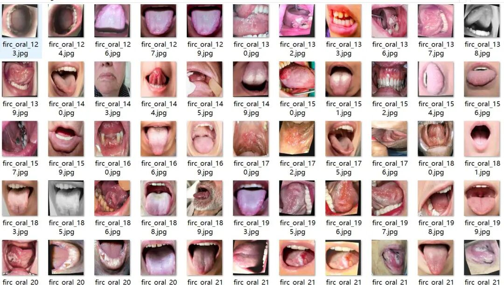
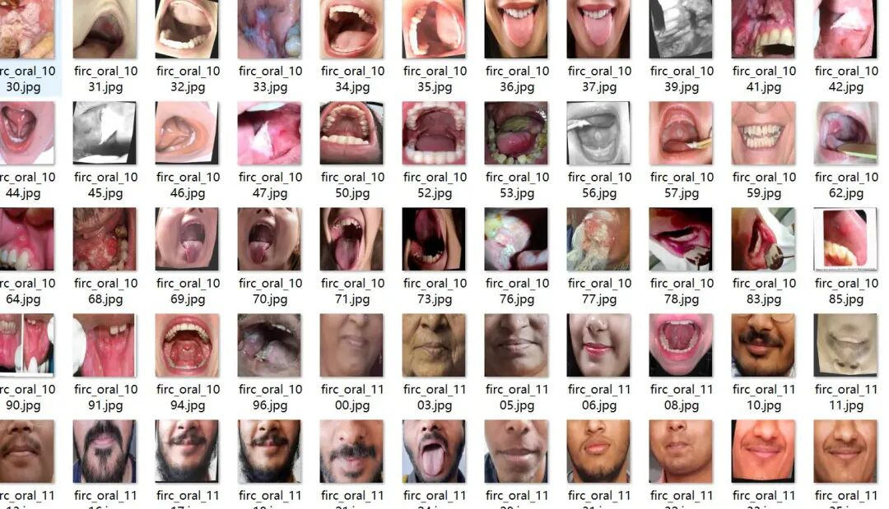
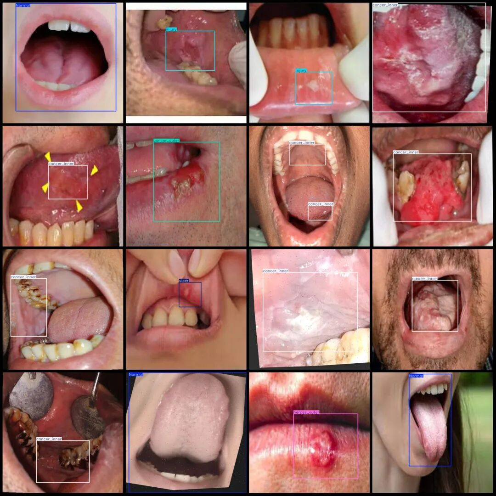

# VOC+YOLO format: 2047 images in 7 categories for oral cancer detection dataset

Dataset format: Pascal VOC format + YOLO format (txt file without split path, only containing jpg images and corresponding VOC format xml files and yolo format txt files)

Number of images (number of jpg files): 2047

Number of annotations (number of xml files): 2047

Number of annotations (number of txt files): 2047

Label category count: 7

Label category names (Note that the order of yolo format categories does not correspond to this, but is based on the classes.txt in the labels folder): ["Normal", "cancer_inner", "cancer_outer", "herpes_inner", "herpes_outer", "injury", "ulcer"]

Number of boxes labeled in each category:

Normal Frames = 620

cancer_inner (internal cavity carcinoma) frame count = 1287

cancer_outer (external cavity carcinoma) frame count = 96

herpes_inner (external cavity herpes)frame count = 35

herpes_outer (external cavity herpes) frame count = 149

Injury (injured) frame count = 143

Number of ulcers (ulcer) = 185

Total frame count: 2515

Image resolution: 640x640

Is the dataset enhanced: a small amount of enhancements

Using labelImg:

Annotation rules: Draw a rectangle around the category.

Important Notice: No

Special : This dataset does not guarantee the accuracy of the trained models or weight files.

Image Preview:

Annotation example:

## Payment

Here is a pay link on Stripe ( https://buy.stripe.com/3cs8yP7sY87d0vu9AB ). Please contact me lonlonago@foxmail.com after funding $89, and I will send you a complete data files , thank you!

